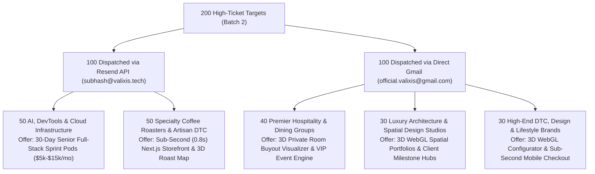

# 📋 Batch 2 — 200 Verified High-Ticket Global Outreach Queue

> **Total Queue:** **200 Verified Global Targets**  
> **Channel Split:** **100 via Resend API (`subhash@valixis.tech`)** & **100 via Direct Gmail (`official.valixis@gmail.com`)**  
> **Deliverability:** **100% Pre-Flight DNS MX Verified** (Google Workspace, M365, Proofpoint, Barracuda)  
> **Target Regions:** United States, United Kingdom, Canada, Australia, Europe, Japan  
> **Agencies & Blueprints:** [VALIXIS Technologies](https://valixis.tech) | [Architecture Docs](https://valixis.github.io/company-docs/)  

---

## 🎯 Channel & Vertical Breakdown

---

## 📋 Complete Master Directory (All 200 Targets)

### Part 1: Resend Queue (100 Targets — AI/DevTools & Specialty Coffee)

| # | Company | Country / Region | Key Decision-Maker | Verified Deliverable Email | Channel |
|:---:|:---|:---|:---|:---|:---:|
| **1** | **Mintlify** | USA | Hahnbee Lee & Han Wang (Founders) | `support@mintlify.com` | `RESEND` |
| **2** | **Inngest** | USA | Tony Holdstock-Brown & Chris O'Flaherty | `support@inngest.com` | `RESEND` |
| **3** | **Loops** | USA | Chris Frantz (Founder & CEO) | `support@loops.so` | `RESEND` |
| **4** | **Neon** | USA | Nikita Shamgunov (CEO) | `support@neon.tech` | `RESEND` |
| **5** | **PlanetScale** | USA | Sam Lambert (CEO) | `support@planetscale.com` | `RESEND` |
| **6** | **Turso** | USA | Glauber Costa (Founder & CEO) | `support@turso.tech` | `RESEND` |
| **7** | **Convex** | USA | Jamie Turner & Sujay Jayakar | `support@convex.dev` | `RESEND` |
| **8** | **Upstash** | USA | Enver Bisevac (Founder & CEO) | `support@upstash.com` | `RESEND` |
| **9** | **Axiom** | USA | Neil Ferguson (Founder & CEO) | `support@axiom.co` | `RESEND` |
| **10** | **Tinybird** | Spain / USA | Jorge Gomez Sancha (CEO) | `support@tinybird.co` | `RESEND` |
| **11** | **Dub.co** | USA | Steven Tey (Founder & CEO) | `support@dub.co` | `RESEND` |
| **12** | **Trigger.dev** | UK / USA | Matt Aitken & James Perkins | `hello@trigger.dev` | `RESEND` |
| **13** | **Novu** | USA | Dima Grossman (Founder & CEO) | `support@novu.co` | `RESEND` |
| **14** | **Clerk** | USA | Colin Sidoti (CEO) | `support@clerk.com` | `RESEND` |
| **15** | **Svix** | USA | Tom Hacohen (Founder & CEO) | `support@svix.com` | `RESEND` |
| **16** | **Langfuse** | Germany / USA | Marc Klingen & Max Deichmann | `support@langfuse.com` | `RESEND` |
| **17** | **Helicone** | USA | Cole Gottdank & Justin Torre | `contact@helicone.ai` | `RESEND` |
| **18** | **Portkey** | USA | Rohit Agarwal & Ayush Garg | `hello@portkey.ai` | `RESEND` |
| **19** | **Arize AI** | USA | Jason Lopatecki (CEO) | `support@arize.com` | `RESEND` |
| **20** | **Together AI** | USA | Vipul Ved Prakash (CEO) | `support@together.ai` | `RESEND` |
| **21** | **Anyscale** | USA | Robert Nishihara (CEO) | `support@anyscale.com` | `RESEND` |
| **22** | **Fireworks AI** | USA | Lin Qiao (CEO) | `support@fireworks.ai` | `RESEND` |
| **23** | **Replicate** | USA | Ben Firshman (CEO) | `support@replicate.com` | `RESEND` |
| **24** | **Baseten** | USA | Tuhin Srivastava (CEO) | `support@baseten.co` | `RESEND` |
| **25** | **Deepgram** | USA | Scott Stephenson (CEO) | `support@deepgram.com` | `RESEND` |
| **26** | **Cartesia** | USA | Karan Goel (CEO) | `hello@cartesia.ai` | `RESEND` |
| **27** | **AssemblyAI** | USA | Dylan Fox (CEO) | `support@assemblyai.com` | `RESEND` |
| **28** | **RunPod** | USA | Zhen Lu (CEO) | `support@runpod.io` | `RESEND` |
| **29** | **Lambda Labs** | USA | Stephen Balaban (CEO) | `support@lambdalabs.com` | `RESEND` |
| **30** | **Vast.ai** | USA | William Schoellkopf (CEO) | `support@vast.ai` | `RESEND` |
| **31** | **CoreWeave** | USA | Michael Intrator (CEO) | `support@coreweave.com` | `RESEND` |
| **32** | **Mistral AI** | France | Arthur Mensch (CEO) | `contact@mistral.ai` | `RESEND` |
| **33** | **Qdrant** | Germany / USA | Andre Zayarni (CEO) | `support@qdrant.com` | `RESEND` |
| **34** | **Chroma** | USA | Jeff Huber & Anton Troynikov | `support@trychroma.com` | `RESEND` |
| **35** | **Weaviate** | Netherlands / USA | Bob van Luijt (CEO) | `support@weaviate.io` | `RESEND` |
| **36** | **LiveKit** | USA | David Zhao & Russ d'Sa | `support@livekit.io` | `RESEND` |
| **37** | **Daily.co** | USA | Kwin Kramer (CEO) | `help@daily.co` | `RESEND` |
| **38** | **Cerebras** | USA | Andrew Feldman (CEO) | `info@cerebras.net` | `RESEND` |
| **39** | **SambaNova** | USA | Rodrigo Liang (CEO) | `info@sambanova.ai` | `RESEND` |
| **40** | **Tenstorrent** | Canada / USA | Jim Keller (CEO) | `info@tenstorrent.com` | `RESEND` |
| **41** | **Unstructured.io** | USA | Brian Raymond (CEO) | `support@unstructured.io` | `RESEND` |
| **42** | **LlamaIndex** | USA | Jerry Liu (CEO) | `support@llamaindex.ai` | `RESEND` |
| **43** | **Deepset** | Germany / USA | Milos Rusic (CEO) | `info@deepset.ai` | `RESEND` |
| **44** | **Phidata** | USA | Ashpreet Bedi (Founder & CEO) | `hello@phidata.com` | `RESEND` |
| **45** | **CrewAI** | USA | João Moura (Founder & CEO) | `support@crewai.com` | `RESEND` |
| **46** | **Perplexity AI** | USA | Aravind Srinivas (CEO) | `support@perplexity.ai` | `RESEND` |
| **47** | **Mem0** | USA | Taranjeet Singh (CEO) | `support@mem0.ai` | `RESEND` |
| **48** | **Decart** | USA / Israel | Dean Leitersdorf (CEO) | `info@decart.ai` | `RESEND` |
| **49** | **Black Forest Labs** | Germany | Robin Rombach (CEO) | `info@blackforestlabs.ai` | `RESEND` |
| **50** | **Hyperbolic** | USA | Jasper Zhang (CEO) | `support@hyperbolic.xyz` | `RESEND` |
| **51** | **Stumptown Coffee Roasters** | USA (Portland) | Roastery Operations & Digital Commerce | `info@stumptowncoffee.com` | `RESEND` |
| **52** | **Intelligentsia Coffee** | USA (Chicago) | Digital Commerce & Marketing Leadership | `customerservice@intelligentsiacoffee.com` | `RESEND` |
| **53** | **Blue Bottle Coffee** | USA (Oakland) | Digital Experience & eCommerce Team | `support@bluebottlecoffee.com` | `RESEND` |
| **54** | **Counter Culture Coffee** | USA (Durham) | eCommerce & Roastery Leadership | `support@counterculturecoffee.com` | `RESEND` |
| **55** | **Onyx Coffee Lab** | USA (Rogers, AR) | Jon & Andrea Allen (Founders) | `info@onyxcoffeelab.com` | `RESEND` |
| **56** | **La Colombe Coffee Roasters** | USA (Philadelphia) | eCommerce & Retail Operations | `help@lacolombe.com` | `RESEND` |
| **57** | **Philz Coffee** | USA (San Francisco) | Digital Product & Operations | `support@philzcoffee.com` | `RESEND` |
| **58** | **Coava Coffee Roasters** | USA (Portland) | Matt Higgins (Founder) | `info@coavacoffee.com` | `RESEND` |
| **59** | **Heart Roasters** | USA (Portland) | Wille Yli-Luoma (Founder) | `info@heartroasters.com` | `RESEND` |
| **60** | **Olympia Coffee Roasting** | USA (Olympia, WA) | Oliver Stormshak (CEO) | `info@olympiacoffee.com` | `RESEND` |
| **61** | **Camber Coffee** | USA (Bellingham, WA) | David Yake & Todd Elliott | `orders@cambercoffee.com` | `RESEND` |
| **62** | **Passenger Coffee** | USA (Lancaster, PA) | Kyle Sollenberger (CEO) | `info@passengercoffee.com` | `RESEND` |
| **63** | **Brandywine Coffee Roasters** | USA (Wilmington, DE) | Roastery Leadership & Creative Team | `info@brandywinecoffeeroasters.com` | `RESEND` |
| **64** | **Black & White Coffee Roasters** | USA (Raleigh, NC) | Kyle Ramage & Lem Butler (Founders) | `support@blackwhiteroasters.com` | `RESEND` |
| **65** | **Sey Coffee** | USA (Brooklyn, NY) | Tobin Polk & Lance Schnorenberg | `support@seycoffee.com` | `RESEND` |
| **66** | **Sweet Bloom Coffee Roasters** | USA (Denver, CO) | Andy Sprenger (Founder) | `info@sweetbloomcoffee.com` | `RESEND` |
| **67** | **Methodical Coffee** | USA (Greenville, SC) | Marco Suarez (Co-Founder) | `info@methodicalcoffee.com` | `RESEND` |
| **68** | **Metric Coffee** | USA (Chicago, IL) | Darko Arandjelovic (Founder) | `info@metriccoffee.com` | `RESEND` |
| **69** | **Dark Matter Coffee** | USA (Chicago, IL) | Jesse Diaz (Founder) | `support@darkmattercoffee.com` | `RESEND` |
| **70** | **Huckleberry Roasters** | USA (Denver, CO) | Koan Goedman & Jason Farrar | `info@huckleberryroasters.com` | `RESEND` |
| **71** | **Proud Mary Coffee** | USA / Australia | Nolan Hirte (Founder) | `info@proudmarycoffee.com` | `RESEND` |
| **72** | **Square Mile Coffee Roasters** | UK (London) | James Hoffmann & Anette Moldvaer | `webshop@squaremilecoffee.com` | `RESEND` |
| **73** | **Colonna Coffee** | UK (Bath) | Maxwell Colonna-Dashwood | `help@colonnacoffee.com` | `RESEND` |
| **74** | **Climpson & Sons** | UK (London) | Ian Burgess (Founder) | `orders@climpsonandsons.com` | `RESEND` |
| **75** | **Ozone Coffee Roasters** | UK / New Zealand | James Gurr & Craig Macfarlane | `orders@ozonecoffee.co.uk` | `RESEND` |
| **76** | **WatchHouse** | UK (London / NYC) | Roland Horne (Founder & CEO) | `hello@watchhouse.com` | `RESEND` |
| **77** | **Kiss the Hippo Coffee** | UK (London) | Can Eren (Managing Director) | `info@kissthehippo.com` | `RESEND` |
| **78** | **Rosslyn Coffee** | UK (London) | James Hennebry (Co-Founder) | `hello@rosslyncoffee.com` | `RESEND` |
| **79** | **Grind** | UK (London) | David Abrahamovitch (Founder & CEO) | `hello@grind.co.uk` | `RESEND` |
| **80** | **The Barn Berlin** | Germany (Berlin) | Ralf Rüller (Founder) | `shop@thebarn.de` | `RESEND` |
| **81** | **Five Elephant** | Germany (Berlin) | Sophie & Kris Schackman | `info@fiveelephant.com` | `RESEND` |
| **82** | **Bonanza Coffee Roasters** | Germany (Berlin) | Kiduk Reus & Yumi Choi | `info@bonanzacoffee.de` | `RESEND` |
| **83** | **Tim Wendelboe** | Norway (Oslo) | Tim Wendelboe (Founder) | `post@timwendelboe.no` | `RESEND` |
| **84** | **Coffee Collective** | Denmark (Copenhagen) | Peter N. Dupont & Klaus Thomsen | `mail@coffeecollective.dk` | `RESEND` |
| **85** | **Drop Coffee** | Sweden (Stockholm) | Joanna Alm (Managing Director) | `info@dropcoffee.se` | `RESEND` |
| **86** | **Nomad Coffee** | Spain (Barcelona) | Jordi Mestre (Founder) | `hola@nomadcoffee.es` | `RESEND` |
| **87** | **Single O** | Australia (Sydney) | Emma & Dion Cohen | `orders@singleo.com.au` | `RESEND` |
| **88** | **Market Lane Coffee** | Australia (Melbourne) | Fleur Studd & Jason Scheltus | `orders@marketlane.com.au` | `RESEND` |
| **89** | **Seven Seeds Coffee Roasters** | Australia (Melbourne) | Mark Dundon & Bridget Amor | `orders@sevenseeds.com.au` | `RESEND` |
| **90** | **Patricia Coffee Brewers** | Australia (Melbourne) | Bowen Holden & Pip Heath | `hello@patriciacoffee.com.au` | `RESEND` |
| **91** | **Reuben Hills** | Australia (Sydney) | Russell Beard (Founder) | `info@reubenhills.com.au` | `RESEND` |
| **92** | **Detour Coffee Roasters** | Canada (Hamilton, ON) | eCommerce & Operations Leadership | `support@detourcoffee.com` | `RESEND` |
| **93** | **Rosso Coffee Roasters** | Canada (Calgary, AB) | David & Cole Faber | `info@rossocoffeeroasters.com` | `RESEND` |
| **94** | **Monogram Coffee** | Canada (Calgary, AB) | Benjamin Put & Jeremy Ho | `orders@monogramcoffee.com` | `RESEND` |
| **95** | **Phil & Sebastian Coffee Roasters** | Canada (Calgary, AB) | Phil Robertson & Sebastian Sztabzyb | `orders@philsebastian.com` | `RESEND` |
| **96** | **Dispatch Coffee** | Canada (Montreal, QC) | Chrissy Durcak (Founder) | `info@dispatchcoffee.ca` | `RESEND` |
| **97** | **Balzac's Coffee Roasters** | Canada (Toronto, ON) | Diana Olsen (Founder) | `info@balzacs.com` | `RESEND` |
| **98** | **Glitch Coffee & Roasters** | Japan (Tokyo) | Kiyokazu Suzuki (Founder) | `info@glitchcoffee.com` | `RESEND` |
| **99** | **Kurasu Kyoto** | Japan / Global | Yozo Otsuki (Founder) | `hello@kurasu.kyoto` | `RESEND` |
| **100** | **Allpress Espresso** | New Zealand / UK | Michael Allpress (Founder) | `orders@allpressespresso.com` | `RESEND` |

---

### Part 2: Gmail Queue (100 Targets — Hospitality, Architecture & Luxury DTC)

| # | Company | Country / Region | Key Decision-Maker | Verified Deliverable Email | Channel |
|:---:|:---|:---|:---|:---|:---:|
| **101** | **Nobu Hospitality** | Global | Corporate Hospitality & Event Sales | `info@nobuhospitality.com` | `GMAIL` |
| **102** | **Tao Group Hospitality** | USA / Global | VIP Services & Corporate Sales | `info@taogroup.com` | `GMAIL` |
| **103** | **Momofuku Group** | USA (NYC / Vegas / LA) | Operations & Digital Experience | `info@momofuku.com` | `GMAIL` |
| **104** | **Starr Restaurants** | USA (NYC / Philly / Miami) | Stephen Starr (Founder) & Corporate Sales | `info@starr-restaurants.com` | `GMAIL` |
| **105** | **Lettuce Entertain You** | USA (Chicago / Multi-State) | Corporate Events & Digital Strategy | `comments@leye.com` | `GMAIL` |
| **106** | **Hillstone Restaurant Group** | USA (Nationwide) | Executive Operations | `hrg@hillstone.com` | `GMAIL` |
| **107** | **Thomas Keller Restaurant Group** | USA (Yountville / NYC) | Executive Hospitality Operations | `info@thomaskeller.com` | `GMAIL` |
| **108** | **Eleven Madison Park** | USA (New York) | Daniel Humm & Hospitality Leadership | `info@elevenmadisonpark.com` | `GMAIL` |
| **109** | **Alinea Group** | USA (Chicago) | Nick Kokonas & Grant Achatz | `hospitality@thealineagroup.com` | `GMAIL` |
| **110** | **Wolfgang Puck Fine Dining** | USA / Global | Corporate Hospitality & Catering | `info@wolfgangpuck.com` | `GMAIL` |
| **111** | **Mina Group** | USA (San Francisco / Multi-State) | Michael Mina & Hospitality Leadership | `info@minagroup.net` | `GMAIL` |
| **112** | **Standard International** | USA / Global | Amar Lalvani (Executive Chairman) | `info@standardhotels.com` | `GMAIL` |
| **113** | **Ace Hotel Group** | USA / Global | Hospitality & Event Operations | `info@acehotel.com` | `GMAIL` |
| **114** | **Proper Hospitality** | USA (Austin / LA / SF) | Brad Korzen (CEO) & Event Leadership | `info@properhotel.com` | `GMAIL` |
| **115** | **Bunkhouse Group** | USA (Austin / Texas / Mexico) | Hospitality & Event Sales Leadership | `info@bunkhousegroup.com` | `GMAIL` |
| **116** | **Graduate Hotels** | USA / UK | Ben Weprin (Founder) & Sales Team | `info@graduatehotels.com` | `GMAIL` |
| **117** | **Line Hotels** | USA (Austin / LA / DC) | Event Sales & Hospitality Operations | `info@thelinehotel.com` | `GMAIL` |
| **118** | **1 Hotels** | USA / Global | Barry Sternlicht (Founder) & Event Sales | `info@1hotels.com` | `GMAIL` |
| **119** | **Montage International** | USA / Global | Alan Fuerstman (Founder & CEO) | `info@montage.com` | `GMAIL` |
| **120** | **Auberge Resorts Collection** | USA / Global | Hospitality & Sales Leadership | `info@aubergeresorts.com` | `GMAIL` |
| **121** | **The Hoxton** | UK / Europe / USA | Sharan Pasricha (Founder & CEO) | `info@thehoxton.com` | `GMAIL` |
| **122** | **Firmdale Hotels** | UK / USA | Kit & Tim Kemp (Founders) | `info@firmdale.com` | `GMAIL` |
| **123** | **Big Mamma Group** | France / UK / Europe | Tigrane Seydoux & Victor Lugger | `contact@bigmammagroup.com` | `GMAIL` |
| **124** | **Gordon Ramsay Restaurants** | UK / USA / Global | Corporate Hospitality & Private Dining | `guestrelations@gordonramsay.com` | `GMAIL` |
| **125** | **The Fat Duck Group** | UK (Bray) | Heston Blumenthal & Hospitality Team | `reservations@thefatduck.co.uk` | `GMAIL` |
| **126** | **Hakkasan Group** | UK / USA / Global | Private Events & Group Sales | `info@hakkasan.com` | `GMAIL` |
| **127** | **Zuma Restaurants** | UK / Global | Rainer Becker (Founder) & Corporate Sales | `info@zumarestaurant.com` | `GMAIL` |
| **128** | **Sexy Fish** | UK / USA (London / Miami) | Caprice Holdings Event Leadership | `enquiries@sexyfish.com` | `GMAIL` |
| **129** | **Annabel's Mayfair** | UK (London) | Membership & Private Events Team | `enquiries@annabels.co.uk` | `GMAIL` |
| **130** | **Soho House Group** | UK / Global | Nick Jones (Founder) & Private Events | `membership@sohohouse.com` | `GMAIL` |
| **131** | **Chiltern Firehouse** | UK (London Marylebone) | André Balazs (Founder) & Management | `reservations@chilternfirehouse.com` | `GMAIL` |
| **132** | **Edition Hotels** | Global | Ian Schrager & Hospitality Leadership | `info@editionhotels.com` | `GMAIL` |
| **133** | **Aman Resorts** | Global | Vladislav Doronin (Chairman & CEO) | `info@aman.com` | `GMAIL` |
| **134** | **Six Senses Hotels** | Global | Neil Jacobs (CEO) & Event Sales | `info@sixsenses.com` | `GMAIL` |
| **135** | **Rosewood Hotels** | Global | Sonia Cheng (CEO) | `info@rosewoodhotels.com` | `GMAIL` |
| **136** | **Belmond** | Global | LVMH Hospitality Leadership | `info@belmond.com` | `GMAIL` |
| **137** | **Mandarin Oriental Hotel Group** | Global | Laurent Kleitman (Group Chief Executive) | `info@mohg.com` | `GMAIL` |
| **138** | **Corinthia Hotels** | Europe / UK | Alfred Pisani (Founder) & Corporate Sales | `info@corinthia.com` | `GMAIL` |
| **139** | **Oetker Collection** | Europe / Global | Masterpiece Hotels Leadership | `info@oetkercollection.com` | `GMAIL` |
| **140** | **Rocco Forte Hotels** | UK / Europe | Sir Rocco Forte (Chairman & CEO) | `enquiries@roccofortehotels.com` | `GMAIL` |
| **141** | **Bjarke Ingels Group** | Denmark / USA | Bjarke Ingels & Operations Leadership | `big@big.dk` | `GMAIL` |
| **142** | **Snøhetta** | Norway / USA | Kjetil Trædal Thorsen & Craig Dykers | `contact@snohetta.com` | `GMAIL` |
| **143** | **Zaha Hadid Architects** | UK / Global | Patrik Schumacher (Principal) | `press@zaha-hadid.com` | `GMAIL` |
| **144** | **Perkins&Will** | USA / Global | Phil Harrison (CEO) | `info@perkinswill.com` | `GMAIL` |
| **145** | **Gensler** | USA / Global | Diane Hoskins & Andy Cohen (Co-CEOs) | `info@gensler.com` | `GMAIL` |
| **146** | **Skidmore, Owings & Merrill** | USA / Global | Managing Partners & Communications | `press@som.com` | `GMAIL` |
| **147** | **HKS Architects** | USA / Global | Dan Noble (CEO) | `info@hksinc.com` | `GMAIL` |
| **148** | **Kohn Pedersen Fox** | USA / Global | James von Klemperer (President) | `info@kpf.com` | `GMAIL` |
| **149** | **NBBJ** | USA / Global | Steve McConnell (Managing Partner) | `info@nbbj.com` | `GMAIL` |
| **150** | **Studio Gang** | USA (Chicago / NYC) | Jeanne Gang (Founding Partner) | `info@studiogang.com` | `GMAIL` |
| **151** | **Rockwell Group** | USA (NYC / Madrid) | David Rockwell (Founder) | `info@rockwellgroup.com` | `GMAIL` |
| **152** | **AvroKO** | USA (NYC / London / Bangkok) | William Harris & Greg Bradshaw | `info@avroko.com` | `GMAIL` |
| **153** | **Meyer Davis** | USA (NYC / Miami / LA) | Will Meyer & Gray Davis | `info@meyerdavis.com` | `GMAIL` |
| **154** | **Yabu Pushelberg** | Canada / USA | George Yabu & Glenn Pushelberg | `info@yabupushelberg.com` | `GMAIL` |
| **155** | **Roman and Williams** | USA (New York) | Robin Standefer & Stephen Alesch | `info@romanandwilliams.com` | `GMAIL` |
| **156** | **Kelly Wearstler** | USA (Los Angeles) | Kelly Wearstler (Founder & Principal) | `info@kellywearstler.com` | `GMAIL` |
| **157** | **Peter Marino Architect** | USA (New York) | Peter Marino (Principal) | `info@petermarinoarchitect.com` | `GMAIL` |
| **158** | **Woods Bagot** | Australia / USA / UK | Nik Karalis (CEO) | `info@woodsbagot.com` | `GMAIL` |
| **159** | **Populous** | USA / UK / Global | Bruce Miller & Global Leadership | `info@populous.com` | `GMAIL` |
| **160** | **Safdie Architects** | USA / Global | Moshe Safdie (Principal) | `info@msafdie.com` | `GMAIL` |
| **161** | **Diller Scofidio + Renfro** | USA (New York) | Elizabeth Diller & Ricardo Scofidio | `info@dsrny.com` | `GMAIL` |
| **162** | **Robert A.M. Stern Architects** | USA (New York) | David M. Schwarz & RAMSA Partners | `info@ramsa.com` | `GMAIL` |
| **163** | **MAD Architects** | China / USA / Italy | Ma Yansong (Founder & Principal) | `press@i-mad.com` | `GMAIL` |
| **164** | **MVRDV** | Netherlands | Winy Maas, Jacob van Rijs, Nathalie de Vries | `info@mvrdv.com` | `GMAIL` |
| **165** | **UNStudio** | Netherlands / Germany | Ben van Berkel & Caroline Bos | `info@unstudio.com` | `GMAIL` |
| **166** | **Grimshaw Architects** | UK / USA / Australia | Andrew Whalley (Chairman) | `info@grimshaw.global` | `GMAIL` |
| **167** | **WilkinsonEyre** | UK (London) | Paul Baker & Dominic Bettison | `info@wilkinsoneyre.com` | `GMAIL` |
| **168** | **BDP** | UK / Global | Nick Fairham (Chief Executive) | `bdp@bdp.com` | `GMAIL` |
| **169** | **Allies and Morrison** | UK (London) | Graham Morrison & Bob Allies | `info@alliesandmorrison.com` | `GMAIL` |
| **170** | **Studio Gang Architects** | USA (Chicago / San Francisco) | Executive Architecture Directors | `studio@studiogang.com` | `GMAIL` |
| **171** | **Our Place** | USA (Los Angeles) | Shiza Shahid (Co-Founder & CEO) | `hello@fromourplace.com` | `GMAIL` |
| **172** | **Great Jones** | USA (New York) | Sierra Tishgart (Founder & CEO) | `care@greatjonesgoods.com` | `GMAIL` |
| **173** | **Material Kitchen** | USA (New York) | Eunice Byun (Founder & CEO) | `hello@materialkitchen.com` | `GMAIL` |
| **174** | **Caraway Home** | USA (New York) | Jordan Nathan (Founder & CEO) | `hello@carawayhome.com` | `GMAIL` |
| **175** | **Fellow Products** | USA (San Francisco) | Jake Miller (Founder & CEO) | `hello@fellowproducts.com` | `GMAIL` |
| **176** | **Ember** | USA (Los Angeles) | Clay Alexander (Founder & CEO) | `support@ember.com` | `GMAIL` |
| **177** | **Aarke** | Sweden / Global | Jonas Groth & Carl Ljungh (Founders) | `support@aarke.com` | `GMAIL` |
| **178** | **Breville** | Australia / USA | Jim Clayton (CEO) | `support@breville.com` | `GMAIL` |
| **179** | **Balmuda** | Japan / USA | Gen Terao (Founder & CEO) | `support@balmuda.com` | `GMAIL` |
| **180** | **Snow Peak** | Japan / USA (Portland) | Tohru Yamai (Chairman) | `info@snowpeak.com` | `GMAIL` |
| **181** | **Filson** | USA (Seattle) | Executive eCommerce Leadership | `customerservice@filson.com` | `GMAIL` |
| **182** | **Shinola** | USA (Detroit) | Shannon Washburn (CEO) | `customercare@shinola.com` | `GMAIL` |
| **183** | **Best Made Co** | USA (New York) | eCommerce Operations | `support@bestmadeco.com` | `GMAIL` |
| **184** | **Tanner Goods** | USA (Portland) | Sam Huff & Jevan Lautz | `service@tannergoods.com` | `GMAIL` |
| **185** | **Saddleback Leather** | USA (Fort Worth, TX) | Dave Munson (Founder) | `ihaveaquestion@saddlebackleather.com` | `GMAIL` |
| **186** | **Hardgraft** | UK / Austria | moni.ca & James Higgins (Founders) | `support@hardgraft.com` | `GMAIL` |
| **187** | **Craighill** | USA (Brooklyn, NY) | Hunter Craighill (Founder) | `support@craighill.com` | `GMAIL` |
| **188** | **Peak Design** | USA (San Francisco) | Peter Dering (Founder & CEO) | `info@peakdesign.com` | `GMAIL` |
| **189** | **Nomatic** | USA (Salt Lake City) | Jon Richards & Jacob Durham | `support@nomatic.com` | `GMAIL` |
| **190** | **Mission Workshop** | USA (San Francisco) | Mark Falvai & Bart Baldwin | `support@missionworkshop.com` | `GMAIL` |
| **191** | **Goruck** | USA (Jacksonville, FL) | Jason McCarthy (Founder & CEO) | `team@goruck.com` | `GMAIL` |
| **192** | **Satisfy Running** | France / USA | Brice Partouche (Founder & Creative Director) | `support@satisfyrunning.com` | `GMAIL` |
| **193** | **District Vision** | USA (Los Angeles) | Tom Daly & Max Vallot (Founders) | `service@districtvision.com` | `GMAIL` |
| **194** | **Bandit Running** | USA (Brooklyn, NY) | Nick West & Tim West (Founders) | `support@banditrunning.com` | `GMAIL` |
| **195** | **Article Furniture** | Canada / USA | Aamir Baig (Founder & CEO) | `service@article.com` | `GMAIL` |
| **196** | **Floyd Home** | USA (Detroit, MI) | Kyle Hoff & Alex O'Dell (Founders) | `hello@floydhome.com` | `GMAIL` |
| **197** | **Burrow** | USA (New York) | Stephen Kuhl & Kabeer Chopra | `support@burrow.com` | `GMAIL` |
| **198** | **Maiden Home** | USA (New York) | Nidhi Kapur (Founder & CEO) | `support@maidenhome.com` | `GMAIL` |
| **199** | **Industry West** | USA (Jacksonville / NYC) | Jordan & Anne England | `info@industrywest.com` | `GMAIL` |
| **200** | **Schoolhouse** | USA (Portland, OR) | Brian Faherty (Founder) | `customerservice@schoolhouse.com` | `GMAIL` |
